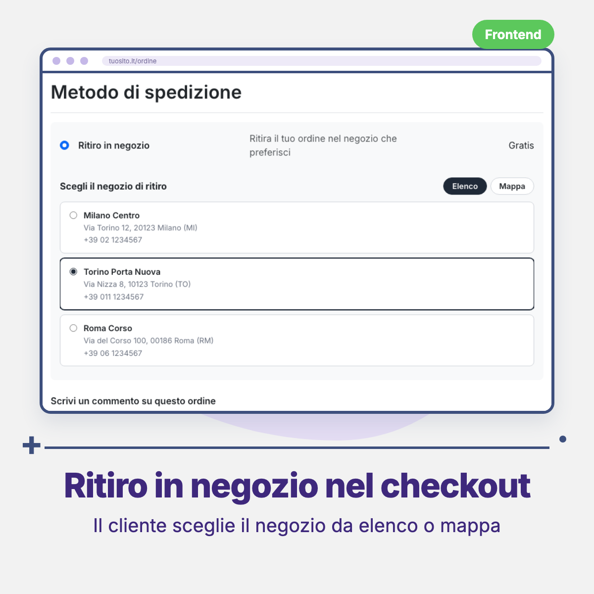
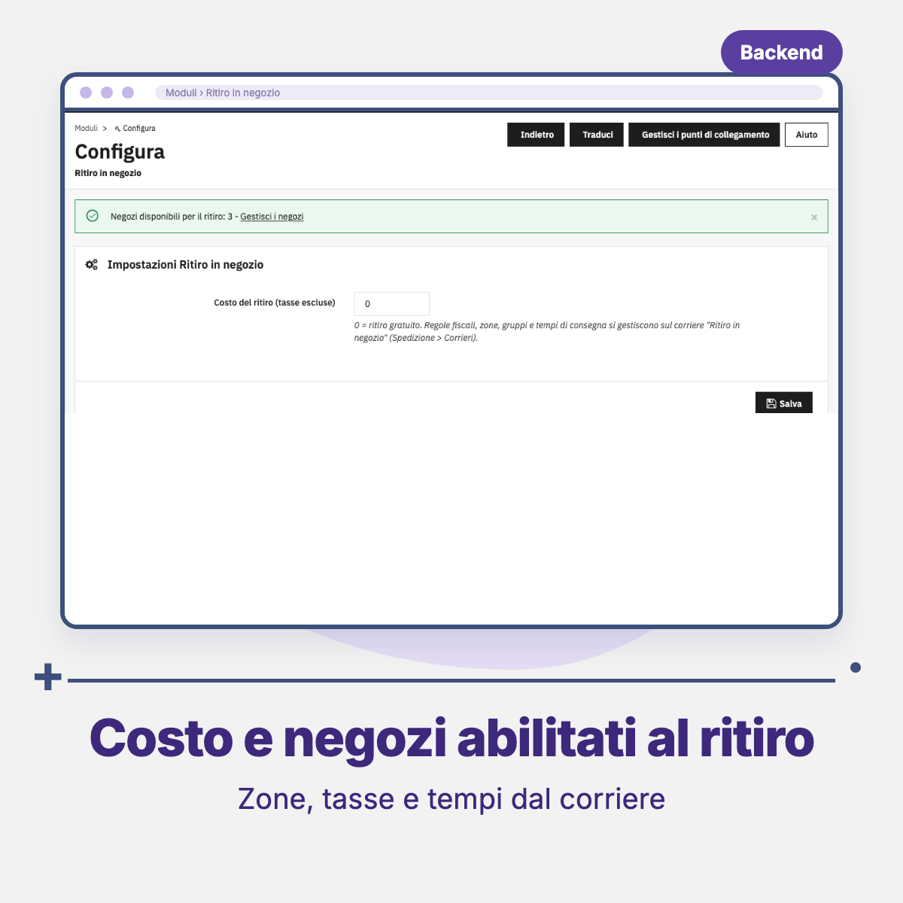

# Threecommerce Store Pickup: pickup in store for PrestaShop

A **Pickup in store** carrier for PrestaShop: at checkout the customer chooses the pickup store from a **list** or a **map**. The chosen store is saved with the order and shown in the order confirmation, the customer order detail, the order emails and the back office order page. It is an add-on of [Threecommerce Store Locator](https://github.com/Threecommerce/prestashop-store-locator) and the PrestaShop port of our Magento 2 store pickup module.

**Compatibility:** PrestaShop 8.0+ / 9.x declared (tested on 9.1.4) · PHP 8.1+ · Hummingbird theme tested
**License:** commercial · coming soon

## Features

- **Carrier** `Pickup in store` created on install (module carrier, active, all zones and customer groups). The cost is set in the module (0 = free, tax excluded); zones, groups, tax rule, delay text and logo are managed on the carrier in *Shipping → Carriers*. Hidden when no store is enabled for pickup.
- **Pickup flag per store**, added to the store form of Threecommerce Store Locator (which is not modified) through its hooks. Only active stores with the flag, associated to the current shop, are offered.
- **Store choice at checkout** from a list or a map (OpenStreetMap or Google Maps, the same configuration as the store locator), shown only when the carrier is selected.
- **Server-side checks**: the shipping step cannot be completed and the order cannot be placed with the pickup carrier without a valid, still enabled store.
- The chosen store is saved with the order (a snapshot of its data) and shown in the order confirmation, order detail, emails and back office.
- The delivery address of the order stays the one entered by the customer: the pickup store is separate data.
- Italian translation included.

## Requirements

- PrestaShop 8.0 or newer, or 9.x
- PHP 8.1 or newer
- [Threecommerce Store Locator](https://github.com/Threecommerce/prestashop-store-locator) 1.x installed and enabled (the installation is refused otherwise)
- A checkout that supports the carrier extra content hook (`displayCarrierExtraContent`)
- Map: OpenStreetMap needs nothing; Google Maps needs the key set in the store locator (without a key the list is shown)

## Tested with

PrestaShop 9.1.4 with the Hummingbird theme. PrestaShop 8, the Classic theme and Google Maps with a real API key have **not** been tested yet. Orders created from the back office with the pickup carrier have no store choice.

## Availability

This module is **not yet available for purchase**. See the [product page](https://www.threecommerce.it/ritiro-in-negozio-prestashop?utm_source=github&utm_medium=readme&utm_campaign=prestashop-store-pickup) for its status, or [get in touch](https://www.threecommerce.it/contatti?utm_source=github&utm_medium=readme&utm_campaign=prestashop-store-pickup) to be notified at launch or to ask for information.

## Configuration

1. **Stores enabled for pickup**: *Shop Parameters → Store Locator*, edit a store and set *Available for pickup* to Yes (the store must also be active).
2. **Cost**: *Modules → Store Pickup → Configure*.
3. **Zones, tax, delay and logo**: *Shipping → Carriers*.
4. **Map**: provider, key and zoom of the store locator configuration.

## Documentation and support

- Product page: [threecommerce.it/ritiro-in-negozio-prestashop](https://www.threecommerce.it/ritiro-in-negozio-prestashop?utm_source=github&utm_medium=readme&utm_campaign=prestashop-store-pickup)
- [Changelog](CHANGELOG.md) (in Italian)
- Support and custom development: [threecommerce.it/contatti](https://www.threecommerce.it/contatti?utm_source=github&utm_medium=readme&utm_campaign=prestashop-store-pickup)

---

*This repository is the public showcase of the module. The source code is kept in a private repository.*
